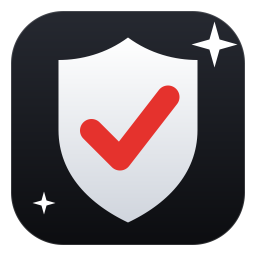

<p align="center">
  
</p>

<h1 align="center">DD Cleaner</h1>

<p align="center">
  Driver checks, system health, network view, security audit, antivirus pages and cleanup for Windows 10 and 11.<br>
  One desktop program for what Windows does not show in one place.
</p>

<p align="center">
  <a href="https://github.com/bsm3d/DD-Cleaner/releases/latest"><b>Download the installer</b></a>
</p>

---

## Overview

DD Cleaner is a Windows desktop application written in Python with PySide6 (Qt). It reads the state of a PC
(drivers, disks, crashes, firewall, connections, startup entries, leftovers) and offers a small number of carefully
guarded actions to repair, harden or clean it.

Two rules shape the whole program:

- **Reading changes nothing.** Every scan, listing, audit and report is read-only.
- **Every change is confirmed and can be undone.** A confirmation always defaults to "No", and the previous state is
  saved first (registry export, driver copy, JSON snapshot, restore point).

## Features

| Tab | What it does |
| --- | --- |
| **Driver Checker** | Checks every driver file against the Microsoft vulnerable driver blocklist and shows whether Windows enforces it. Lists third-party drivers by age. Finds driver packages no device uses and removes them, or uninstalls a driver completely, with a saved copy each time. |
| **System Health** | Health report for the last 30 days: disks and SMART, free space, blue screens, hardware errors, crashes, pending restart. Repair tools (SFC, DISM, network reset) with live output. Startup programs with signature and file-type checks. DPC / ISR load. Inventory of the PC and its installed programs. |
| **Firewall & Network** | Live traffic per application and per destination, a world map of where the PC connects, firewall profiles and risky rules, blocked traffic from the firewall log, adapters and listening ports with their exposure. |
| **Security** | Audit with a score out of 100 across System, Accounts, Network and Data. Three hardening profiles (Basic, Recommended, Strict), advanced tweaks, and a dated list of changes to undo. |
| **Antivirus** | Scans with ClamAV: chosen items, quick scan or full scan, in parallel, with a quarantine. Running processes and persistence hunt (services, scheduled tasks, hijacked settings) with removal of what you tick. Watched folders, scheduled quick scan, custom YARA rules, VirusTotal lookups. |
| **Garbage** | Finds files and folders by word or wildcard, leftovers of uninstalled programs and dead registry entries. Charts of what was found and what was freed. Deleted files go to the Recycle Bin by default; registry keys are exported to a `.reg` file first. |

Across the program: filters and CSV export on result lists, a status-bar Stop button, and the window remembers its
size, pages and options.

## Requirements

- Windows 10 or 11, 64-bit.
- Administrator rights. The installed program asks for elevation at every start.
- **ClamAV for Windows**, for the scans of the Antivirus tab only. It is not bundled: install it from
  [clamav.net](https://www.clamav.net/) into `C:\Program Files\ClamAV`, then use "Update signatures" in the program.
  Everything else works without it.

## Installation

1. Download `DD_Cleaner_Setup_3.0.exe` from the [releases page](https://github.com/bsm3d/DD-Cleaner/releases/latest).
2. Run it and accept the Windows prompt. It installs to `C:\Program Files\DD Cleaner`.
3. Start DD Cleaner from the Start Menu.

The installer offers no other location on purpose. The program runs as administrator, so its folder must be one that
only administrators can change; it checks this at every start and warns if the folder is not protected.

No Python is needed on the PC: the installer contains its own runtime.

## Running from source

Developed and tested with Python 3.14 and PySide6 6.11.

```bash
pip install -r requirements.txt
```

```bash
python DD_Cleaner.py
```

Run from source, the program does not ask for elevation by itself: start it from an administrator terminal, or use
the "Restart as administrator" button in its status bar. Its data (logs, downloaded lists, backups) is then kept in
the project folder; all of it is excluded from version control.

### Tests

```bash
python -m pytest tests
```

The suite runs off screen. It never changes the real system: registry writes stay under a dedicated test key, file
operations stay in temporary folders, and services, restore points and hardening are mocked.

### Building the installer

Requires [PyInstaller](https://pyinstaller.org/) and [Inno Setup 6](https://jrsoftware.org/isinfo.php).

```bash
python -m PyInstaller DD_Cleaner.spec --noconfirm
```

```bash
"%LOCALAPPDATA%\Programs\Inno Setup 6\ISCC.exe" DD_Cleaner.iss
```

The result is `dist_installer\DD_Cleaner_Setup_3.0.exe`. `build_installer.bat` runs both steps.

## Project layout

```
DD_Cleaner.py          Entry point and application style
security_audit.py      Audit and hardening engine
ddcleaner/             Logic modules, without Qt (drivers, health, firewall, traffic, garbage, ClamAV...)
ddcleaner/ui/          Interface: main window and one module per tab
ddcleaner/data/        Icon and world map outlines
tests/                 Test suite
tools/                 Scripts that generate the icon and the map data
DD_Cleaner.spec        PyInstaller build
DD_Cleaner.iss         Inno Setup installer
README.txt             User manual shipped with the installer
```

## Safety design

- **Protected folders.** The program refuses to run from a folder a standard user can write to, and keeps its data in
  `C:\ProgramData\DD Cleaner`, created for SYSTEM and Administrators only.
- **Hardened child processes.** System tools are started by absolute path with a cleaned environment, never through a
  shell.
- **Backups before changes.** Registry keys, scheduled tasks, driver packages and hardening settings are saved before
  they are touched.
- **Protected items.** Core Windows keys, core drivers and system paths cannot be selected for deletion.
- **Secrets stay on screen.** Saved passwords and keys are shown only after a confirmation, are never written to a
  file or to the log, and a copied secret leaves the clipboard after 30 seconds.

## Network connections

DD Cleaner works offline. It connects to the Internet only for the features below, and asks before each download.

| Feature | Contacts | What is sent |
| --- | --- | --- |
| Vulnerable driver blocklist | Microsoft | Nothing (download only) |
| ClamAV signatures | database.clamav.net | Nothing (download by freshclam) |
| Server locations on the map | db-ip.com | Nothing (download, lookups then run locally) |
| Host names in live traffic | Your DNS server | Remote addresses, for reverse lookups |
| Address owners (off by default) | Regional Internet registries (RDAP) | Public IP addresses, once per network block |
| VirusTotal (your own API key) | virustotal.com | A file's hash; a file itself only after an explicit confirmation |

## Keyboard shortcuts

| Key | Action |
| --- | --- |
| F5 | Run the main scan of the page on screen |
| Esc | Stop the running scans |
| Ctrl+F | Go to the filter of the list on screen |
| Space | Tick or untick the selected rows |
| Ctrl+C | Copy the selected rows |
| Ctrl+L | Show the log |
| Ctrl+, | Preferences |
| Ctrl+Q | Quit |

## Credits

- Antivirus engine: [ClamAV](https://www.clamav.net/) (installed separately).
- IP geolocation: [DB-IP](https://db-ip.com/) City Lite, licensed under Creative Commons Attribution 4.0.
- Map outlines: [Natural Earth](https://www.naturalearthdata.com/) (public domain).
- Interface: [Qt for Python (PySide6)](https://doc.qt.io/qtforpython-6/).

## Disclaimer

The hardening, tweak, repair and removal features modify system settings. Even with the safeguards above, use the
program at your own risk and keep a restore point or a full backup of your system.

## Author

Benoit (BSM) Saint-Moulin
