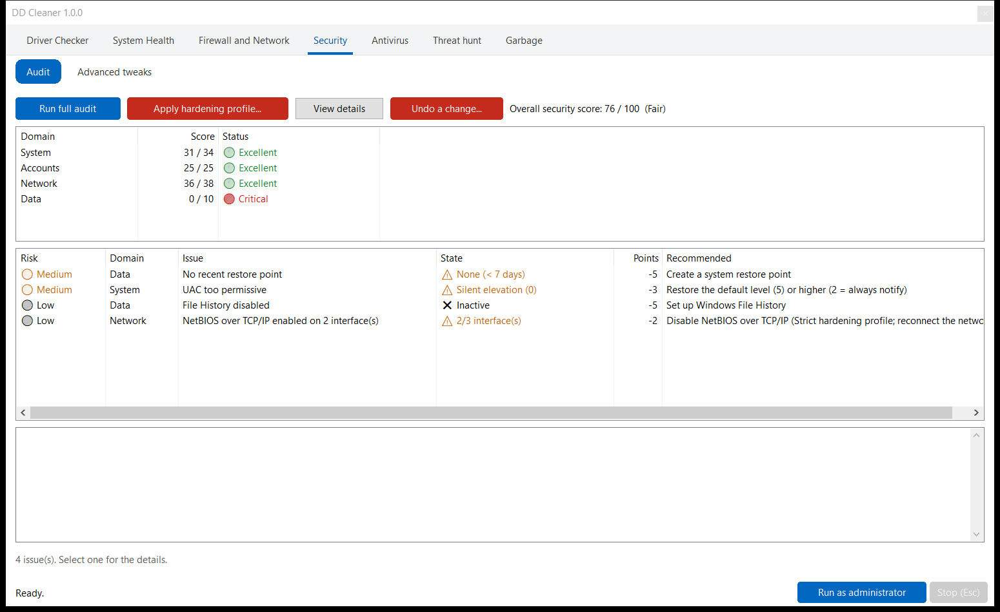

# DD Cleaner 1.0.0

Plain C++17 and the Win32 API, built with MSYS2 (UCRT64). No Qt, no Python, no runtime to install: the executables are
linked statically.

| Target | What it is |
| --- | --- |
| `ddcore` | The engine (library): everything the Python version does except the window. |
| `ddc.exe` | Command line front end: `presets`, `search`, `leftovers`, `usage`, `registry`, `startup`, `hunt`, `audit`, `secrets`. Nothing is changed unless `--delete --yes` is given. `secrets` hides the values unless `--show`. |
| `DD_Cleaner.exe` | The Win32 window, 7 groups of pages (below). |
| `ddcore_tests.exe` | Self-contained tests (about 2700 checks): fake data, a scripted VirusTotal server, a fake registry for the hardening engine, and the real PC for the readers. |

## Screenshots

| | |
| --- | --- |
|  |  |
| Driver age, coloured by how old the driver is. | Health report, with the event log marker and clearing. |
|  |  |
| Security audit and hardening profiles. | Antivirus scan (ClamAV). |

## The window

Same layout as the Python version: Driver Checker (vulnerable drivers, age, unused, complete uninstall), System Health
(report, repair tools, startup programs, DPC/ISR load, inventory with the saved-passwords window), Firewall and Network
(live traffic, world map, firewall, network), Security (audit and hardening profiles, advanced tweaks with undo),
Antivirus (ClamAV scan, quarantine, signature update, VirusTotal), Threat hunt (processes, persistence with removal,
protection), Garbage (files and folders, registry, overview).

Esc stops the running task, F5 refreshes the page, Ctrl+C copies the selected rows. `--group N --page M` opens a page;
`--shot file.bmp [--refresh] [--delay ms]` saves a picture of the window and quits (used to check the layout).

Every deletion, removal or change asks first and saves a backup before touching anything (`.reg`, `.xml`, `.json`, a copy
of the file, a driver export). The data lives in `%APPDATA%\BSM\DDCleaner` (override: `DDCLEANER_HOME`).

## Build

```bash
export PATH=/c/msys64/ucrt64/bin:/c/Program\ Files/CMake/bin:$PATH
cmake -S cpp -B cpp/build -G Ninja -DCMAKE_BUILD_TYPE=Release
cmake --build cpp/build
cpp/build/ddcore_tests.exe
```

MSYS2 packages needed: the UCRT64 toolchain and `mingw-w64-ucrt-x86_64-sqlite3` (read the Chromium password databases).
CMake comes from `C:\Program Files\CMake`.

## Differences from the Python version

- The charts of the Garbage overview are text bars in lists, the DPC/ISR and traffic views are lists, not drawn graphs.
- The world map is drawn with GDI (countries, cities, links, route hops); it has zoom, drag, hover and the same clicks.
- A browser database is copied to `%APPDATA%\BSM\DDCleaner\tmp` for a moment (and deleted at once) because the browser
  keeps the original locked. The Python version copied it to the Windows temp folder.
- `vt_lookup` refuses a 200 answer that is not JSON instead of showing "0 engines".
- Not verified by a human click-through: the dialogs that change the system (hardening, uninstalling drivers, removal of
  startup or hunt entries) were tested with fake systems in `ddcore_tests`, not on the real PC.
