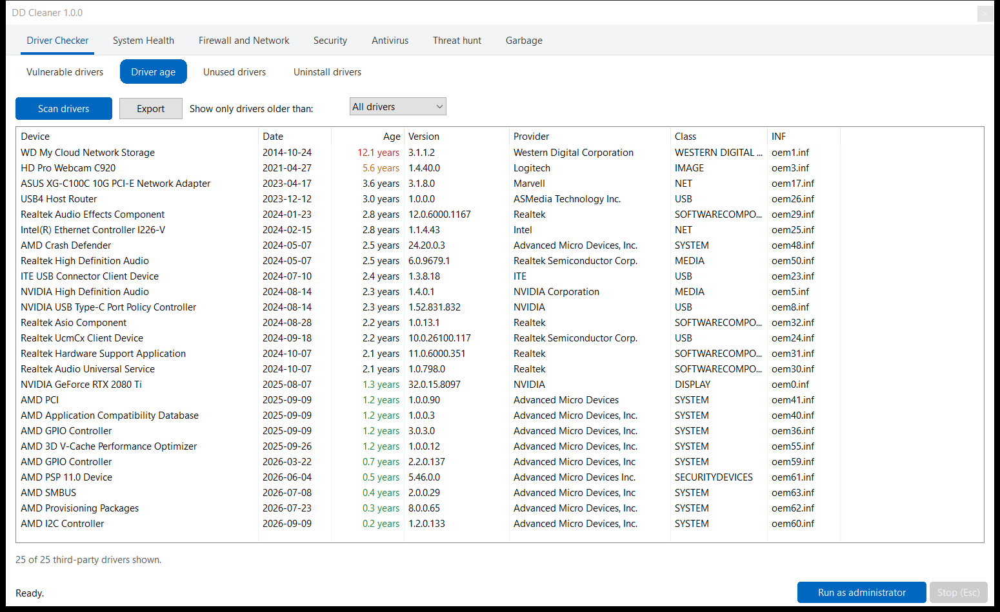
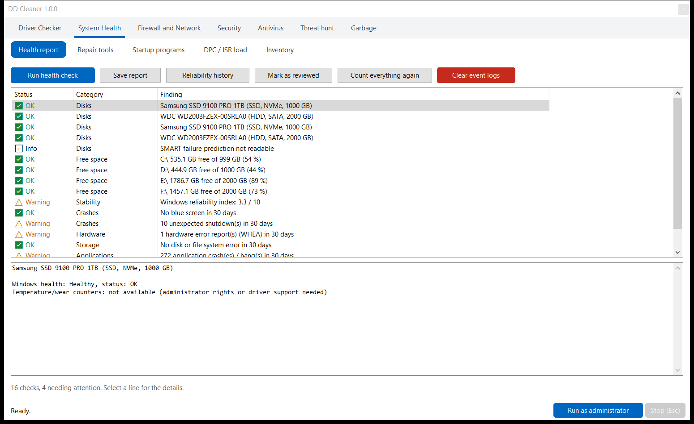
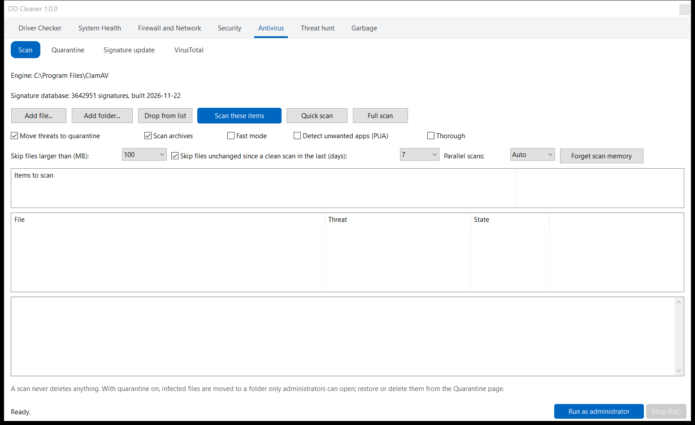

# DD Cleaner

A cleaning and maintenance tool for Windows, written in C++17 with the Win32 API. The executables are linked
statically: nothing else to install.

| | |
| --- | --- |
|  |  |
| Driver age | Health report |
|  |  |
| Security audit | Antivirus scan |

## What it does

- **Drivers:** vulnerable, old and unused drivers, complete uninstall.
- **System health:** report, repair tools, startup programs, DPC/ISR load, inventory with saved passwords.
- **Network:** live traffic, world map, firewall.
- **Security:** audit, hardening profiles, advanced tweaks with undo.
- **Antivirus:** ClamAV scan, quarantine, signature update, VirusTotal.
- **Threat hunt:** processes, persistence and its removal, protection.
- **Garbage:** files, folders and registry.

Every deletion or change asks first and saves a backup before touching anything. Esc stops the running task, F5
refreshes the page, Ctrl+C copies the selected rows.

## Command line

`ddc.exe` offers `presets`, `search`, `leftovers`, `usage`, `registry`, `startup`, `hunt`, `audit` and `secrets`.
Nothing is changed unless you add `--delete --yes`. `secrets` hides the values unless you add `--show`.

## Data

The data stays in `%APPDATA%\BSM\DDCleaner` (or the folder named by `DDCLEANER_HOME`).

## Build

MSYS2 (UCRT64 toolchain and `mingw-w64-ucrt-x86_64-sqlite3`) and CMake.

```bash
export PATH=/c/msys64/ucrt64/bin:/c/Program\ Files/CMake/bin:$PATH
cmake -S cpp -B cpp/build -G Ninja -DCMAKE_BUILD_TYPE=Release
cmake --build cpp/build
cpp/build/ddcore_tests.exe
```

## Not verified yet

The dialogs that change the system (hardening, driver uninstall, removal of startup or hunt entries) are tested
against fake systems only, not clicked through on a real PC.
